  

  

  
  
  

I build full-stack and applied-ML products from end to end: **Python/FastAPI** and **TypeScript/React** services, **PyTorch** model pipelines, GPU inference, and graphics and audio in the browser. I care about software that is tested, typed, secure, and fast on ordinary hardware.

- 🎓 Dual degree (B.Tech + M.Tech) in Computer Science, **NIT Hamirpur**
- 🐫 Previously community ambassador at **[CAMEL-AI](https://github.com/camel-ai/camel)** (multi-agent systems, MCP servers)
- 🎧 Currently building **[Unmix](https://github.com/Harsh1tSh/unmix)**, below

---

## 🎧 Featured: Unmix

**Pull a recording apart by source.** Talk over a song, or drop any clip, and neural models split it into voices, drums, bass, guitar, piano and the rest, separate your voice from the singer's, and transcribe the lyrics word by word. Free, open source, and it runs on your own machine.

  

- **Models:** BS-RoFormer, HT-Demucs and MossFormer2 for separation, Whisper for word-timed lyrics; the stems sum exactly back to the mix
- **Backend:** FastAPI job pipeline with live progress and automatic CUDA / DirectML / Apple / CPU selection with measured fallback (37x faster on a T4 GPU than on CPU)
- **Frontend:** sample-locked playback of every stem in Web Audio (hover a card to hear one source), a live mode over WebSockets, in-browser inference in WebAssembly, and a WebGL2 particle sphere at 60 fps
- **Quality:** 170+ automated tests and a full security review

<a href="https://github.com/Harsh1tSh/unmix"><b>→ github.com/Harsh1tSh/unmix</b></a>

---

## 🛠️ More things I've built

| Project | What it is | Built with |
|---|---|---|
| **[DataVisual](https://github.com/Harsh1tSh/datavisual)** · [live](https://harsh1tsh.github.io/datavisual/) | Design a database schema on a canvas and get versioned migration files for Supabase, PostgreSQL, MySQL and SQLite, each following that database's own rules. Imports existing migrations or SQL dumps, runs fully in the browser and never touches a live database. | JavaScript (no framework), SVG, PWA, PGlite, Playwright |
| **LyricLight** *(private for now)* | One photo + a song → a lyric video where the words sit behind the person and their light falls on the scene. Segmentation and depth models, WebGL compositing, H.264 encoded in the browser. | Python, FastAPI, BiRefNet, Depth Anything V2, React, WebGL, WebCodecs |
| **[Sky Skirmish](https://github.com/Harsh1tSh/sky-skirmish)** | A browser jetpack shooter with 4 modes, 12 weapons and bots, where every sprite and sound is generated in code: no asset files at all. | TypeScript, Vite |
| **[AI Project Planner](https://github.com/Harsh1tSh/AI-Project-Planner)** | A team of AI agents that turns a project idea into a technical architecture and a timeline. | Python, CAMEL-AI, Mistral, Streamlit |
| **[AutoMax](https://github.com/Harsh1tSh/Django_app)** | Full-stack car marketplace with token auth, role-based permissions and filtered search. | Django REST, React, PostgreSQL |

## 🌱 Open source

- **CAMEL-AI**: merged (#2773)
- **OWL** (CAMEL-AI's multi-agent assistant): merged a [community use-case example (#434)](https://github.com/camel-ai/owl/pull/434).

## 🐍 Contributions

  <picture>
    <source media="(prefers-color-scheme: dark)" srcset="https://raw.githubusercontent.com/Harsh1tSh/Harsh1tSh/output/github-snake-dark.svg" />
    
  </picture>

## 🧰 Tech I work with

   
   
   
  

Also: ONNX Runtime, Whisper, Web Audio API, WebSockets, OpenAPI, Playwright, pytest, Vitest, multi-agent systems and MCP.

<i>Open to interesting problems and good teams. Say hi on <a href="https://www.linkedin.com/in/harshit-sharma-6b883a193/">LinkedIn</a>.</i>

